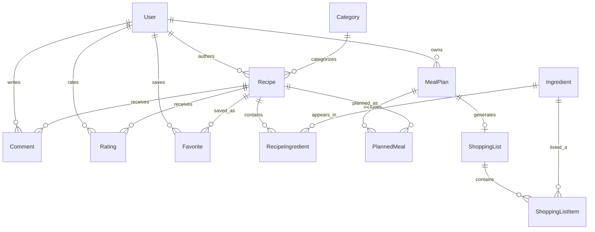

# TasteNest – podatkovni model

## Podatkovna baza
Relacijska podatkovna baza **PostgreSQL**, dostop prek **Prisma ORM**. Primarni ključi so `UUID`, datumi se hranijo kot časovni žigi oziroma datumi; tujim ključem so dodani indeksi. Imena spodaj so konceptualna in se lahko v implementaciji preslikajo v Prisma modele.

## Entitete in glavna polja
| Entiteta | Glavna polja | Namen |
|---|---|---|
| `User` | `id` PK, `name`, `email` UNIQUE, `password_hash`, `role`, `is_active`, `created_at` | Uporabniki in vloge |
| `Category` | `id` PK, `name` UNIQUE | Kategorije receptov |
| `Recipe` | `id` PK, `author_id` FK, `category_id` FK, `title`, `description`, `instructions`, `base_servings`, `prep_minutes`, `status`, `created_at` | Recepti; status `PUBLISHED` ali `HIDDEN` |
| `Ingredient` | `id` PK, `name` UNIQUE | Standardizirane sestavine |
| `RecipeIngredient` | `id` PK, `recipe_id` FK, `ingredient_id` FK, `quantity` DECIMAL, `unit` | Sestavine in količine za izvirne porcije |
| `Comment` | `id` PK, `user_id` FK, `recipe_id` FK, `content`, `created_at`, `is_hidden` | Komentarji |
| `Rating` | `id` PK, `user_id` FK, `recipe_id` FK, `score`, `created_at` | Ocene 1–5 |
| `Favorite` | `user_id` FK, `recipe_id` FK, `created_at` | Priljubljeni recepti; sestavljeni PK |
| `MealPlan` | `id` PK, `user_id` FK, `week_start` DATE, `created_at` | Tedenski načrt posameznika |
| `PlannedMeal` | `id` PK, `meal_plan_id` FK, `recipe_id` FK, `day` DATE, `meal_type`, `servings` | Obrok v načrtu |
| `ShoppingList` | `id` PK, `meal_plan_id` FK UNIQUE, `generated_at` | Zadnji generirani seznam za načrt |
| `ShoppingListItem` | `id` PK, `shopping_list_id` FK, `ingredient_id` FK, `quantity` DECIMAL, `unit`, `checked` | Združene nakupovalne postavke |

Skupaj **12 povezanih entitet**. Slike receptov niso nujne za MVP; kasneje je mogoče dodati `RecipeImage` z referenco na shranjeno sliko.

## Povezave
- `User` 1:N `Recipe` (avtorstvo), `Comment`, `Rating`, `MealPlan`; `User` N:M `Recipe` prek `Favorite`.
- `Category` 1:N `Recipe`.
- `Recipe` N:M `Ingredient` prek `RecipeIngredient` z dodatnima poljema `quantity` in `unit`.
- `Recipe` 1:N `Comment`, `Rating`, `PlannedMeal`.
- `MealPlan` 1:N `PlannedMeal` in 1:0..1 `ShoppingList`.
- `ShoppingList` 1:N `ShoppingListItem`; `Ingredient` 1:N `ShoppingListItem`.

## Osnutek ER-diagrama

## Omejitve in integriteta
- `User.email`, `Category.name` in `Ingredient.name` so unikatni (imena sestavin se pred shranjevanjem normalizirajo).
- `Favorite`: sestavljeni PK (`user_id`, `recipe_id`); `Rating`: UNIQUE (`user_id`, `recipe_id`).
- `MealPlan`: UNIQUE (`user_id`, `week_start`); `week_start` je ponedeljek izbranega tedna.
- `RecipeIngredient`: UNIQUE (`recipe_id`, `ingredient_id`, `unit`); `ShoppingListItem`: UNIQUE (`shopping_list_id`, `ingredient_id`, `unit`).
- `Recipe.base_servings > 0`, `PlannedMeal.servings > 0`, `RecipeIngredient.quantity > 0`, `ShoppingListItem.quantity > 0`, `Recipe.prep_minutes >= 0`, `Rating.score BETWEEN 1 AND 5`.
- `PlannedMeal.day` mora spadati v sedemdnevno obdobje `MealPlan.week_start`; preverjanje se izvede v storitvenem sloju.
- `RecipeIngredient.unit` in `ShoppingListItem.unit` uporabljata nabor `g`, `kg`, `ml`, `l`, `kos`; pri generiranju se `kg` pretvori v `g`, `l` v `ml`, ostale enote se ne združujejo med seboj.
- Uporabnik lahko spreminja le svoje `MealPlan`, `PlannedMeal`, `ShoppingList` in `ShoppingListItem`.
- Brisanje receptov v MVP je logično (`HIDDEN`), da se ohranijo sklici iz načrtov in komentarjev.
- Generiranje nakupovalnega seznama poteka v transakciji: izbriše prejšnje postavke, ustvari nove in posodobi `generated_at`.

## Primer izračuna
Če ima recept za 2 porciji 200 g testenin, načrtovan pa je za 3 porcije, je potrebna količina `200 × 3 / 2 = 300 g`. Če drug načrtovan recept potrebuje 150 g testenin, sistem na nakupovalnem seznamu ustvari eno postavko: **450 g testenin**.
