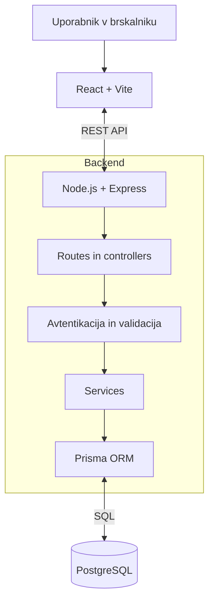

# TasteNest – arhitektura in tehnološki sklad

## Arhitekturni pristop
Sistem je **modularni monolit s tremi plastmi**: odzivni frontend, REST API z domensko logiko in relacijska podatkovna baza. Frontend nikoli neposredno ne dostopa do baze.



## Glavni deli sistema
- **Frontend:** React komponente in strani za recepte, podrobnosti recepta, prijavo, priljubljene, tedenski načrt in nakupovalni seznam; klici API prek `fetch`.
- **Backend:** Express usmerjevalniki, kontrolerji, validacija vhodnih podatkov, avtentikacija, preverjanje vlog/lastništva in servisna poslovna logika.
- **Baza:** PostgreSQL z relacijami, indeksi, unikatnimi omejitvami in transakcijami; Prisma skrbi za shemo in migracije.

## Komunikacija in primer procesa
Frontend pošilja zahteve HTTP s telesom JSON na `/api`. Primeri poti:
- `POST /api/auth/register`, `POST /api/auth/login`, `GET /api/auth/me`;
- `GET /api/recipes`, `GET /api/recipes/:id`, `POST /api/recipes`, `PATCH /api/recipes/:id`;
- `POST /api/recipes/:id/comments`, `PUT /api/recipes/:id/rating`, `POST /api/recipes/:id/favorite`;
- `GET /api/meal-plans/:weekStart`, `POST /api/meal-plans/:weekStart/meals`;
- `POST /api/meal-plans/:weekStart/shopping-list/generate`, `PATCH /api/shopping-list-items/:id`.

**Primer:** uporabnik doda recept v tedenski načrt in zahteva generiranje seznama. Backend preveri identiteto in lastništvo načrta, pridobi načrtovane obroke in sestavine, izračuna količine glede na porcije, pretvori `kg → g` in `l → ml`, združi količine po sestavini in enoti ter v transakciji shrani nov seznam. Odgovor JSON frontend prikaže kot nakupovalni seznam. Pri naknadnih spremembah načrta je potrebna ponovna generacija.

## Avtentikacija in avtorizacija
- Registracija ustvari račun z vlogo `USER`; skrbnik lahko vlogo spremeni v `AUTHOR` ali `ADMIN`.
- Gesla se shranjujejo kot zgoščene vrednosti z `bcrypt` (nikoli v čisti obliki).
- Prijava vrne kratkoživ JWT, ki ga frontend pošlje v `Authorization: Bearer` glavi. V MVP se žeton hrani v pomnilniku aplikacije, ne v `localStorage`; po osvežitvi strani se uporabnik ponovno prijavi.
- Express middleware preverja podpis in veljavnost JWT, aktivnost uporabnika, vlogo ter lastništvo vira. Pravice na frontendu so le uporabniška pomoč, ne varnostna meja.
- Za produkcijsko uporabo bi bilo treba dodati HTTPS, varno upravljanje sej oziroma osvežitvenih žetonov, omejevanje poskusov prijave in ustrezno upravljanje skrivnosti.

## Tehnološki sklad in utemeljitve
| Del | Tehnologija | Zakaj |
|---|---|---|
| Frontend | React + Vite | Komponentni uporabniški vmesnik in hiter razvoj |
| Backend | Node.js + Express | Enoten jezik JavaScript in preprost REST API |
| Podatkovna baza | PostgreSQL | Relacije, omejitve, konsistentnost in transakcije |
| ORM | Prisma | Tipizirana shema modelov, migracije in poizvedbe |
| Avtentikacija | JWT + bcrypt | Preverjanje identitete in varno shranjevanje gesel |
| Avtorizacija | RBAC + preverjanje lastništva | Ločevanje vlog in zasebnih podatkov |
| Lokalni razvoj | Node.js, npm, Docker Compose | Ponovljiv lokalni zagon baze |
| Testiranje | Vitest + Supertest | Enotski testi izračunov in integracijski testi API |
| Verzije | Git | Sledenje spremembam |

**Arhitekturne odločitve:** modularni monolit je za obseg vaj manj zahteven od mikrostoritev; REST je pregleden za vire aplikacije; PostgreSQL je primeren za povezane entitete; Prisma olajša migracije. Izračun nakupovalnega seznama ostane na backendu, da je enoten in ga je mogoče testirati.

Podrobne utemeljitve, alternative in posledice so zapisane v ADR-jih: [React + Vite](adr/0001-react-vite.md), [Node.js + Express](adr/0002-nodejs-express.md), [PostgreSQL in primerjava z MongoDB](adr/0003-postgresql.md), [Prisma](adr/0004-prisma.md), [JWT](adr/0005-jwt-avtentikacija.md) in [REST API](adr/0006-rest-api.md). Novi zapisi uporabljajo [minimalno predlogo MADR](adr/adr-template.md).

## Predlagana struktura repozitorija
```text
TasteNest/
├── frontend/
│   ├── src/components/
│   ├── src/pages/
│   └── src/services/
├── backend/
│   ├── src/routes/
│   ├── src/controllers/
│   ├── src/services/
│   ├── src/middleware/
│   └── prisma/schema.prisma
├── docs/
│   ├── 01-zasnova-resitve.md
│   ├── 02-funkcionalnosti-in-obseg.md
│   ├── 03-podatkovni-model.md
│   └── 04-arhitektura-in-tehnoloski-sklad.md
├── docker-compose.yml
└── README.md
```

## Lokalni zagon
**Predpogoji:** nameščen Node.js (LTS), npm in Docker z Docker Compose. Predvideni razvojni naslovi: frontend `http://localhost:5173`, API `http://localhost:3000`, PostgreSQL `localhost:5432`.

1. V korenu projekta zaženemo PostgreSQL: `docker compose up -d`.
2. V `backend/` nastavimo `.env` (`DATABASE_URL`, `JWT_SECRET`, `PORT=3000`), izvedemo `npm install`, `npx prisma migrate dev` in `npm run dev`.
3. V `frontend/` nastavimo `VITE_API_URL=http://localhost:3000/api`, izvedemo `npm install` in `npm run dev`.
4. Po potrebi inicializacijski skript ustvari administratorja in osnovne kategorije ter sestavine.

Ukazi so **predvideni za kasnejšo implementacijo**; datoteke `package.json`, `.env.example`, Docker Compose in skripte bo treba ustvariti pri programiranju. API omogoča lokalni CORS samo za razvojni naslov frontenda. Gesel in skrivnosti ne shranjujemo v repozitorij.

## Nadaljnji razvoj
Arhitektura omogoča dodajanje domače shrambe, priporočil, oznak in napredne moderacije kot novih modulov brez spremembe osnovne zasnove.
