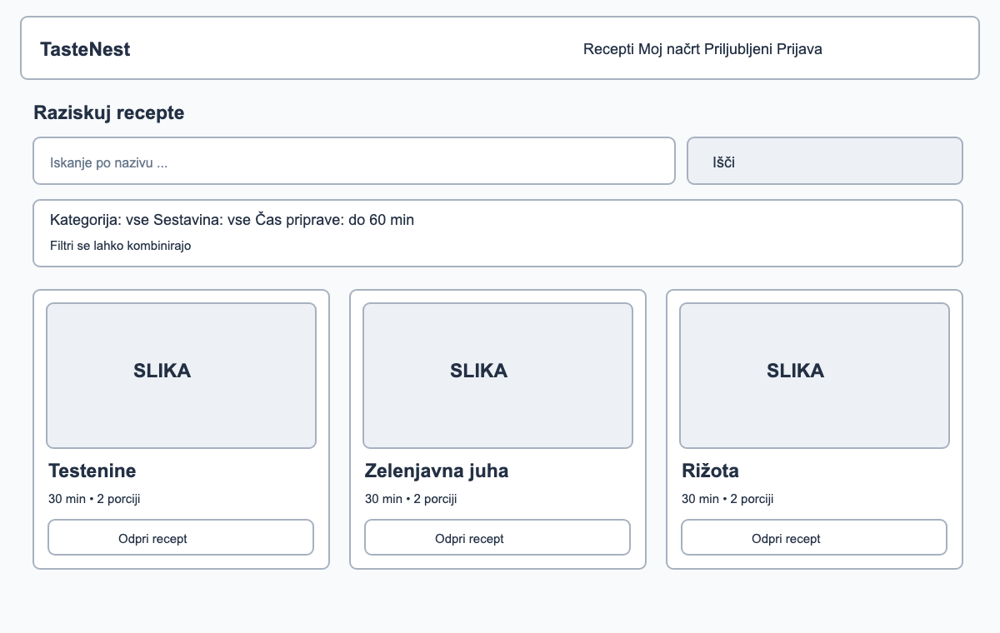
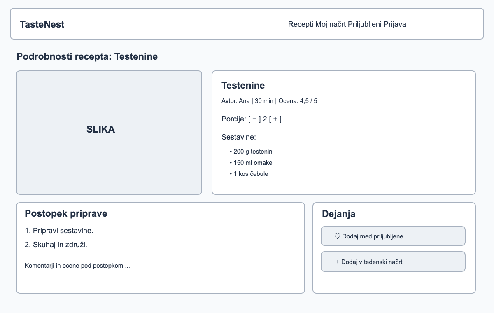
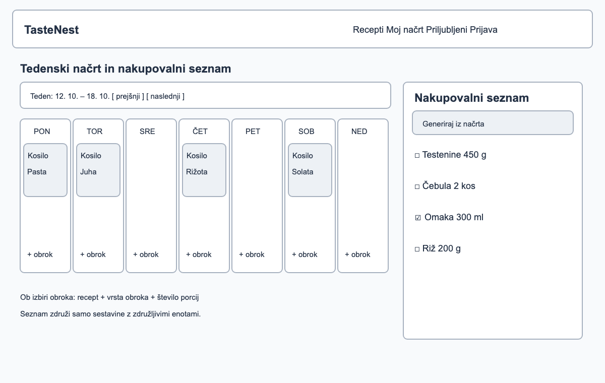

# TasteNest – žični modeli (wireframes)

Žični modeli so sheme zaslonov za MVP. Prikazujejo osnovno razporeditev elementov in uporabniške poti, ne končnega grafičnega oblikovanja. Spodaj so vključene pretvorbe v PNG z oznakami WF-01–WF-03; izvirne datoteke SVG so ohranjene v isti mapi `docs/wireframes/`. Vsak PNG ohranja celotno vsebino in izvirno razmerje stranic SVG (1200 × 760 slikovnih pik).

## WF-01 – Pregled in iskanje receptov

[Izvirnik SVG](wireframes/01-pregled-receptov.svg)

Prikaz javnega seznama objavljenih receptov, iskalnega polja, kombiniranih filtrov in kartic receptov. **Povezane zgodbe:** US-04 (iskanje in filtriranje), US-03 (prikaz objavljenega recepta).

## WF-02 – Podrobnosti recepta

[Izvirnik SVG](wireframes/02-podrobnosti-recepta.svg)

Prikaz recepta, sestavin, postopka, izbire porcij ter dejanj za priljubljene in dodajanje v načrt; spodaj je predviden prostor za komentarje in ocene. **Povezane zgodbe:** US-05 (komentiranje), US-06 (ocenjevanje), US-07 (priljubljeni), US-08 (dodajanje v načrt), US-10 (prilagajanje porcij).

## WF-03 – Tedenski načrt in nakupovalni seznam

[Izvirnik SVG](wireframes/03-tedenski-nacrt-in-nakupi.svg)

Razporeditev receptov po dnevih, dodajanje obrokov ter generiranje in označevanje postavk nakupovalnega seznama. **Povezane zgodbe:** US-08 (tedenski načrt), US-09 (nakupovalni seznam).

Slike receptov so ponazoritvena mesta iz izvirnih shem; nalaganje slik po podatkovnem modelu ni obvezni del MVP. WF-02 predvideva prikaz povprečne ocene; avtorski statistični pregled iz US-20 ostaja kasnejša nadgradnja. Ti trije zasloni prikazujejo osrednjo uporabniško pot, ne vseh obrazcev za prijavo, avtorstvo in administracijo.

## Navigacija

`Pregled receptov → Podrobnosti recepta → Dodaj v tedenski načrt → Generiraj nakupovalni seznam`
